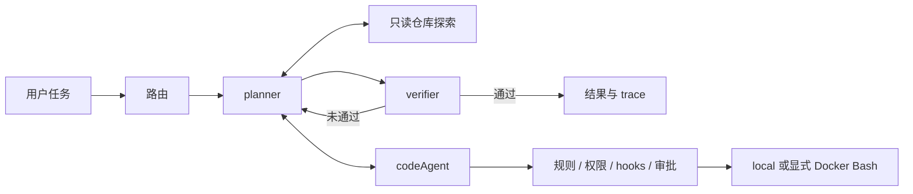

# MokioAgent / MokioClaw

面向本地代码任务的 Agent 工程项目：用 LangGraph 组织探索、规划、实现和验收，并保留工具审批、取消、运行中纠正、恢复及可追踪记录。默认完整多 Agent 流程，默认本机执行。



本轮加入可选 Docker 前台 Bash、独立代码验收器和固定 12 题评测集。正式 56 次真实试验已归档：**完整交付 0/56，部分产物通过 8/56**。此前另有 56 次因配置继承缺陷标为无效对照，原记录全部保留。当前交付可靠性仍需改善，不声称多 Agent 优于单 Agent。[结果、限制与失败分析](docs/experiments/internship-v1/RESULTS.md)。

新增一个小型真实模型成功案例：full 流程自主修复 FIFO 队列边界，正常汇报后独立 Docker 验收 **5/5 通过**，归档重建后再次通过。使用 19 次请求、18 次工具、约 37 秒生成；这是受控单例，不计入历史矩阵。[播放演示与复现](docs/internship/demo.md)。

另已完成冻结 B0/B1 的 **18 次真实任务对照**：完整交付分别为 **1/9、0/9**，独立产物通过均为 **8/9**。完成预算预留让 B1 的 9 次运行均进入验收，但本批未改善完整交付率。成功与失败案例均可从归档重建。[对照报告](docs/experiments/job-readiness-goal2/RESULTS.md)、[失败分析](docs/experiments/job-readiness-goal2/ANALYSIS.md)、[真实记录回放](docs/experiments/job-readiness-goal2/DEMO.md)。

| 可复核内容 | 证据 |
|---|---|
| 366 项原始检查基线 | [基线记录](docs/experiments/internship-baseline-2026-10-16.json) |
| 当前 444 项检查通过，真实 Docker 29 项通过 | [Goal 2 检查证据](docs/experiments/job-readiness-goal2/checks/) |
| 真实 ARM64 容器隔离、输出和超时清理 | [Docker 实测](docs/experiments/docker-arm64-2026-10-16.json) |
| 12 题缺陷版失败 / 参考修复通过 | [任务清单与验收](docs/experiments/internship-v1/) |
| baseline/full/light/auto 公平比较口径 | [评测设计](docs/internship/evaluation.md) |
| 56 次正式试验及 56 次无效对照均保留 | [实际结果](docs/experiments/internship-v1/RESULTS.md) |
| 150 秒真实模型完整交付回放，另保留失败案例 | [演示](docs/internship/demo.md) |
| 三个 v2 任务环境、角色诊断及完成预算预留 | [Goal 1 设计、离线实验与 B0/B1](docs/experiments/job-readiness-v1/) |

## 快速运行

需要 Python 3.13 和 uv。离线演示不需要密钥：

```sh
uv sync --frozen
uv run python examples/internship_offline.py
make check
uv run mokioclaw eval list
uv run mokioclaw eval run --profile core
```

真实模型使用已有 OpenAI 兼容接口。复制 `.env.example` 到 `.env`，填写自己的 MODEL、BASE_URL、API_KEY：

```sh
uv run mokioclaw "分析当前仓库并修复你能验证的问题" --workspace /absolute/path/to/workspace
uv run mokioclaw tui --workspace /absolute/path/to/workspace
```

Docker 需显式开启，启动引擎并准备依赖镜像：

```sh
docker build -t mokioclaw-execution:0.2.0 docker/execution
uv run mokioclaw doctor --execution-backend docker --json
make check-docker
uv run mokioclaw "执行项目测试并解释结果" --workspace /absolute/path/to/workspace --execution-backend docker
```

Docker 仅覆盖前台 Bash 和独立验收；MCP、Python hooks 和文件工具仍在宿主运行，工作区中的秘密仍可被容器读取。后台 Bash 不支持 Docker，不会自动回落到 local。[完整边界与故障排查](docs/internship/execution.md)。

## 学习与复现

- [原教学说明与各阶段实验](docs/teaching-guide.md)
- [评测任务、预算、冻结与恢复](docs/internship/evaluation.md)
- [取消、截断、审批复盘](docs/internship/postmortems.md) · [时序图与面试自测](docs/internship/interview.md)
- [贡献和展示口径](docs/internship/contribution.md) · [本地发布候选与已知限制](docs/internship/release-candidate.md)
- [协议契约](docs/WIRE_PROTOCOL.md) · [评测契约](docs/EVAL_SCHEMA.json)
- 真实模型实验必须显式加 `--real-model`，普通 CI 不调用模型。

这是用于学习与工程展示的本地 Agent。公开案例可能已进入模型训练数据；本项目的离线子集不代表官方 SWE-bench 成绩，也不据此声称未见任务泛化。
