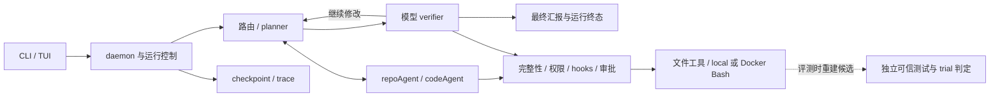

# MokioAgent / MokioClaw

面向本地代码任务的 Agent 工程学习项目。用 LangGraph 组织探索、规划、实现和验收，重点研究：**模型生成不完整时不执行工具、运行中纠正使旧调用失效、用独立测试区分产物与交付**。默认完整多 Agent 流程、local 执行；light/auto 与 Docker 均需显式配置。



**从这里看项目：** [展示包入口](docs/internship/showcase/README.md) · [架构](docs/internship/showcase/architecture.md) · [实验表](docs/internship/showcase/experiments.md) · [三条执行链](docs/internship/showcase/chains.md)

| 已验证事实 | 原始证据与限制 |
|---|---|
| D01 单文件任务正常结束，可信 Docker 测试 5/5；19 次请求、18 次工具、36.845 秒生成 | [既有 150 秒讲解回放](docs/internship/demo.md)，受控单例，不代表跨文件能力 |
| 正式 56 次矩阵完整交付 0/56，独立产物通过 8/56 | [正式结果](docs/experiments/internship-v1/RESULTS.md)；另 56 次配置不一致的无效对照保留 |
| 后续 B0/B1 各 9 次：完整交付 1/9、0/9；产物通过均 8/9 | [冻结对照](docs/experiments/job-readiness-goal2/RESULTS.md)，没有证明完成预算预留提升交付率 |
| Linux 普通检查 455 通过、2 跳过；真实 Docker 29 通过；wheel 干净安装通过 | [CI 运行](https://github.com/nicedream18/CodeAgent/actions/runs/39028453552)，对应 `748ca5d`，不是后续文档提交 |

当前没有证据支持多 Agent 优于单 Agent；跨多个源文件修改后的完整交付仍未验证。上述各批次分母独立，测试通过数不是解题成功率。[事实和限制索引](docs/internship/showcase/FACTS.md)。

[Context Compression A/B Benchmark](docs/experiments/context-compression-v1/README.md)提供相同 full 流程下的压缩开关对照，比较包含摘要开销的 token、独立交付率与延迟；未加 `--real-model` 只预览，不产生效果数据。

## 快速体验（不需要模型凭证）

需要 Python 3.13、uv。首次安装需要联网或已有依赖缓存；安装后的以下示例与回放不访问模型，也不需要 Docker：

```sh
uv sync --frozen
uv run --no-sync mokioclaw --help
uv run --no-sync python examples/internship_offline.py
uv run --no-sync python scripts/replay_internship_demo.py docs/internship/success-demo.cast --no-wait
uv run --no-sync python scripts/inspect_showcase_case.py verifier-budget
```

离线示例使用固定响应模型，输出 `simulation=true`、`real_model=false`；不计入真实任务成绩。案例查看器只读归档，不重放工具。[干净环境步骤、预期输出和排错](docs/internship/showcase/reproduce.md)。

## 使用自己的模型

将 `.env.example` 复制为 `.env`，填写自己的 `MODEL`、`BASE_URL`、`API_KEY`，再针对自己的工作区运行：

```sh
uv run mokioclaw "阅读项目并提出可验证的修改" --workspace /absolute/path/to/workspace
uv run mokioclaw tui --workspace /absolute/path/to/workspace
```

默认 local 的命令在宿主执行，工具仍经过权限和审批。Docker 仅隔离前台 Bash 与独立评分；文件工具、MCP 和 Python hooks 仍在宿主，挂载工作区中的秘密仍可能被读取。准备镜像与真实检查见[执行边界](docs/internship/execution.md)和[复现说明](docs/internship/showcase/reproduce.md)。

## 开发与学习

- `make check`：冻结安装、pytest、Ruff、mypy、协议/评测文档和 diff 检查；普通 CI 不调用真实模型。
- [教学说明](docs/teaching-guide.md) · [工具与评测契约](docs/internship/contracts.md) · [评测设计](docs/internship/evaluation.md)
- [工程复盘](docs/internship/postmortems.md) · [核心取舍](docs/internship/showcase/tradeoffs.md) · [简历草稿](docs/internship/showcase/resume.md)
- [维护练习](docs/internship/showcase/practice.md) · [当前状态](docs/internship/STATUS.md) · [贡献与 AI 辅助范围](docs/internship/contribution.md)

公开任务可能已进入模型训练数据。本地固定子集不是官方 SWE-bench 成绩，不据此声称未见任务泛化。
