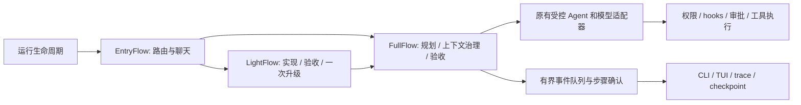

# CrewAI Flow 迁移

本项目使用 CrewAI **Flows** 替代 LangGraph 的状态调度。保留现有模型适配器、工具循环、审批、取消、补充指令、上下文治理和持久化。本次不把已有执行 Agent 改为 CrewAI Agent/Crew，也不引入另一套自主工具调用机制。

## 数据流



- `orchestration/flows.py` 的 `@start`、`@router`、`@listen` 由真实 CrewAI 调度，负责分支、循环与结束。
- `orchestration/runtime.py` 把 CrewAI 的执行适配为现有 `stream` / `invoke` 接口。保留原事件名称及 `graph_event` 包装，以兼容客户端和旧 trace 消费者。
- CrewAI 只持有可序列化的 FlowCursor。含锁、审批等待、模型客户端的 RuntimeState 和业务状态由每次独立执行会话持有，不交给框架深拷贝或另一套存储。
- `orchestration/messages.py` 处理按消息 ID 替换、删除及压缩后的整体重置；旧 checkpoint 的清除标记继续可读。
- `graph/` 模块路径保留，供已有插件、测试替换点和恢复入口导入；生产源码不再导入 LangGraph。

## 流式事件和故障边界

自定义模型/工具事件通过容量 128 的队列增量传递，队列满时背压，不累积无界中间事件。节点完成后，生产者等待消费者确认，之后才允许 CrewAI 启动下一节点。因此事件消费端可以先保存 checkpoint、应用补充指令或结束旧流程。

取消、生成错误、预算停止和重新规划异常原样传播。关闭流会停止后续节点并等待当前生产者退出，生命周期收尾后不再有该 Flow 的事件。已经启动的普通同步工具仍遵守原超时及副作用保留语义。后台 Subagent 保留独立 RunControl。

轻量升级会转发嵌套 full Flow 的模型/工具事件。单 Agent 评测基线也使用独立的 SingleStepFlow，仍只执行同一 codeAgent 的工具循环。

本地 trace/checkpoint 仍是记录来源。CrewAI 遥测、AMP tracing、自动 embedding memory 和额外持久化均关闭，框架控制台输出也不会混入 NDJSON 或 TUI。没有增加 CrewAI 隐式模型请求或工具重试。

## 依赖与使用

- Python `>=3.13,<3.14`，CrewAI 固定 `1.15.28`。
- 使用 `langchain-core` 和 `langchain-openai` 保留消息、工具 schema 与既有兼容模型接口；删除 LangGraph 及完整 LangChain 编排包的直接依赖。
- MCP SDK 调整为 `>=1.28.1,<1.29`，以满足固定 CrewAI 的依赖约束；本项目继续使用原 stdio 封装、按调用启停、审批及诊断，不启用 CrewAI MCP DSL。
- CrewAI 的分发依赖包含数据库相关包，但本项目没有启用其向量存储或自动 memory。首次安装体积会增加。

现有命令保持不变：

```sh
uv sync --frozen
uv run mokioclaw --help
uv run python examples/internship_offline.py
uv run mokioclaw "任务" --workspace /absolute/path/to/workspace
uv run mokioclaw tui --workspace /absolute/path/to/workspace
```

无需 CrewAI 云端账户或额外模型凭证；仍使用原来的 MODEL / BASE_URL / API_KEY。CrewAI 导入时仍可能初始化其用户配置目录；本项目未使用其云端登录信息。离线检查采用临时 HOME，模型密钥与个人配置不进入测试或安装报告。

框架的自动 memory 开关和控制台输出适配涉及固定版本接口，因此升级 CrewAI 时必须重跑编排专项、流式取消、纠正、MCP、恢复与完整回归，不能只更新版本号。

## 证据边界

原来的 56 次矩阵、上下文压缩 A/B、D01 演示、旧 Docker 评分镜像和远程 Linux CI 均保留在各自冻结版本。本次迁移不重写其数据，不将旧成功率或延迟归属于 CrewAI，不自动追加真实模型试验或推送。

迁移验证使用可控离线模型与本地 stdio 服务，没有请求真实模型。结果见 [本地验收归档](experiments/crewai-migration-v1/README.md)：

- macOS ARM64：`make check` 为 **496 passed / 2 skipped**；Ruff、38 个严格 mypy 模块、协议/评测文档与 diff 检查通过。
- 真实容器 **33 passed / 0 skipped**：命令使用新 Linux ARM64 镜像，历史固定任务评分使用旧冻结依赖；另在新禁网镜像执行 11 个编排测试通过，所属容器清理确认。镜像 ID 见归档；旧评分镜像和标签未覆盖。
- 全新虚拟环境安装实际 wheel，仓库外验证 CLI、依赖、site-packages 和禁网的真实 SingleStepFlow；107 个包内 Python 文件与被测源码一致。
- 离线端到端示例：3 次固定响应、2 次文件工具，独立断言 `add(2,3) == 5` 通过；只验证执行链，不作为真实解题成绩。
- 事实索引、展示包和教学文档本地链接检查通过。没有推送、远程 CI 或发布。

重跑普通检查及新镜像容器验证：

```sh
make check
docker build -t mokioclaw-crewai-migration:20261020 docker/execution
docker build -t mokioclaw-legacy-eval:local docker/legacy-eval
MOKIO_DOCKER_IMAGE=mokioclaw-crewai-migration:20261020 MOKIO_EVAL_DOCKER_IMAGE=mokioclaw-legacy-eval:local make check-docker
uv build --wheel --out-dir /tmp/mokio-crewai-wheel
```

当前执行镜像构建允许显式 `--build-arg PIP_INDEX_URL=...` 选择准备阶段的下载源，默认仍为官方 PyPI。依赖版本在锁文件及导出的 requirements 中固定；执行阶段不联网、不自动回落宿主。

首次新镜像检查发现历史任务的 MCP 2 源码不能在 MCP 1 镜像内评分，失败及修复过程保留在归档。`docker/legacy-eval/` 原样保留基线的 Dockerfile 与依赖，不把历史任务迁移为 CrewAI；CI 分别构建并记录两个镜像。日常选择新执行镜像可用现有 `--docker-image mokioclaw-crewai-migration:20261020`，不需覆盖旧默认标签。

参考：[CrewAI Flows](https://docs.crewai.com/v1.15.28/en/concepts/flows)、[CrewAI 遥测配置](https://docs.crewai.com/v1.15.28/en/telemetry)。
