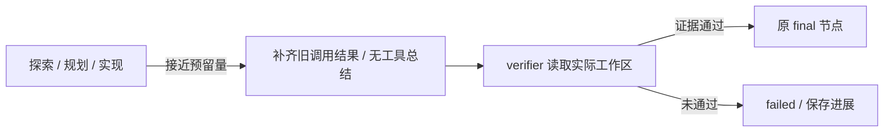

# 完成预算预留：B1 设计

## 目标与数据流

有限预算下，避免实现反复读取耗尽全部容量，给已有工作留下总结和独立模型验收的机会。
只在完整图的 planner 开始时激活；无运行上限时不激活。baseline 和未升级的 light 沿用原路径；auto 升级后进入 planner 即采用同一机制。默认 full/local 不变。



`RuntimeState.completion_budget` 是运行局部对象，阶段为 implementation/report/verification。
模型请求仍通过原 invoke_streaming，检查取消、补充要求、上下文和硬预算；在请求计数递增之前检查完成预留。
工具沿用参数、静态权限、hooks 和审批链，在审批前及每次实际尝试前检查预留，重试不能花掉保留量。该检查不授予权限。

## 预留与硬预算

固定预留量：4 次请求（一个同步专家总结、三个 verifier 请求），2 次工具（预期读取与检查）。
当前请求的真实输入估算和所选模型输出预算用于预测：`4 * (input_estimate + output_budget)`。
普通请求后若无法保留上述容量，或普通工具后少于两个执行名额，切换为 draining。
事件记录触发原因、角色、当前累计量、上限及估算依据。它是启发式预测，不是已经消费或供应商费用。
总结和验收阶段可以使用剩余预算，仍受原 token/request/tool 硬检查；不会增加上限，也不保证三个请求一定足够。
阶段验收实际可能超过预测或失败，必须按原控制流停止；小预算也可能较早交接。效果需要 Goal 2 的真实试验确认。

## 协议、状态及故障边界

- CompletionYield 是内部控制信号，不能当作普通工具故障重试。
- 未执行的当前/后续调用补 ToolMessage；已经开始的包装调用记 interrupted，已完成结果不重复覆盖。
- ToolConversation 将补齐结果同步到 produced messages，避免下一节点看到悬空调用。
- code/repo 使用原角色、无工具模型做一次事实总结。意外工具调用全部关闭，不执行副作用；无模型内容时内部消息标注 source=runtime，不冒充模型响应。
- planner 一旦收到 drained 子任务结果，保留声明的状态更新，作废同批后续委派并交给 verifier。
- draining 期间压缩使用现有确定性降级，保留任务/规则/验收与事实引用；按真实 node 判断，不能被子 Agent 的 active role 覆盖。
- verifier 只能基于实际检查给 passed。draining 后未通过时保存验证信息，以 failed / completion_verification_failed 收尾，不再次委派实现。此原因表示完成策略停止，不表示实际 token 恰好耗尽。
- 取消和补充要求优先：受保护总结再次检查原控制对象。补充要求进入新规划时重新估算剩余预算，旧调用和迟到批准仍失效。
- 后台子任务显式清空父 completion_budget，继续使用独立控制；没有父阶段对象共享。
- checkpoint 增加可选摘要 completion_budget，旧文件可读。恢复不复用旧 draining 对象或旧通过结论，按当前规则/文件和剩余配置重算。
- 原 final 节点不新增模型请求。正常/异常/中断仍复用原生命周期保存 checkpoint、trace 和唯一终态。

## 离线实验

`examples/completion_budget_demo.py` 是故意重复读取的固定模型，输入/输出计量均为合成值，完全不调用真实 API。
同一驱动分别通过 PYTHONPATH 运行 Git archive 的 B0 源码与 B1 源码，文件需求、模型输出和预算相同。

| 限制场景 | B0 | B1 |
|---|---|---|
| 10 请求 | 10 请求后停止，修改保留，未进入验收 | 9 请求，完成读验收和收尾 |
| 1,800 合成 token | 15 请求后停止，修改保留 | 10 请求，完成验收 |
| 7 工具 | 7 工具后停止，修改保留 | 6 工具，完成验收（模型请求由 9 增为 10） |

最后一行体现取舍：保留验收可能增加模型请求，不能宣称所有指标都下降。
另有 verifier 返回失败的负例，实际为 failed，修改仍保留。所有结果在 offline-controls，不能混入真实任务成功率。

```sh
uv run python examples/completion_budget_demo.py --kind requests
uv run python examples/completion_budget_demo.py --kind tokens
uv run python examples/completion_budget_demo.py --kind tools
uv run python examples/completion_budget_demo.py --fail-verification
```

回归覆盖：真实图和同步子 Agent、未启动旧委派、token/request/tool 边界、工具重试、意外总结工具、取消和纠正、确定性压缩、light/strict checkpoint 与终态 trace、旧恢复摘要及后台隔离。
已有规则、MCP 动态 schema、审批撤销、full/light/auto 和恢复等仍通过全量回归验证；本轮没有真实模型效果结论。
