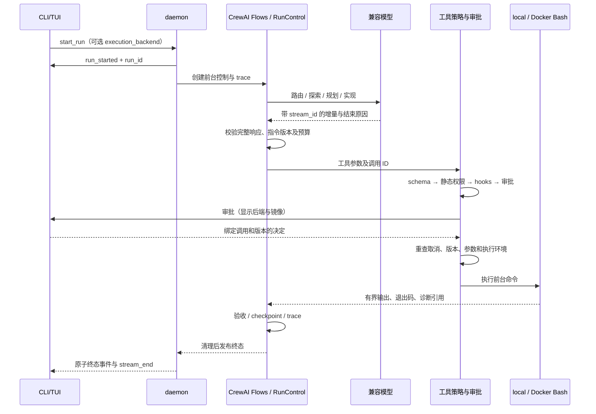

# 面试讲解与自测

## 一次运行的数据流

评测复用模型与执行循环，但直接使用受限运行配置，跳过 daemon 交互。baseline 没有模型 verifier，最终判断来自同一外部 Docker 验收器。

## 需要能解释的不变量

1. 没有完整模型响应和完整原始参数，就不能执行工具；截断批次全部作废。
2. 最新用户补充要求使尚未开始的旧调用失效，迟到批准不能恢复它。
3. 取消是前台运行的控制信号，独立后台任务不共享该对象。
4. 终态只在资源清理后发布，状态与最后一条订阅事件保持原子可见。
5. 审批不能提升静态权限，保存规则不能跨后端或镜像复用。
6. 回退只覆盖 FileWrite/FileEdit，必须比较 after_hash，不能覆盖用户后续编辑。
7. 模型自评、运行终态、独立验收和安全断言互不替代；空报告不能成功。
8. 真实实验版本冻结，失败不可删除，重复三次不能挑选最好一次作为整体结论。

## 问答练习

- 为什么使用 CrewAI Flows，而不把执行器改为 CrewAI Agent/Crew？Flow 显式表达路由、循环与节点边界；原有模型—工具循环继续统一管理审批、取消、纠正和预算，避免引入第二套隐式模型请求与重试。完整流程是否更有效仍须看固定任务对照，不能凭框架或架构复杂度判断。
- baseline 是否故意减弱工具？没有，执行 Agent 复用同一文件/搜索/Bash/Skill 能力和全局预算，只去掉协调与模型验收。
- light 为何可能更贵？验收未通过或需要跨文件时升级到 full，前面的请求已经消耗；需要查看实际路径而非只看配置名称。
- temperature=0 为什么还要重复？外部服务与生成仍可能存在差异，三次只是小样本，不能用来声称稳定泛化。
- token 预算是不是费用硬上限？不是，输入估算加输出预留可能与实际 usage 不同；供应商价格配置缺失时不推算费用。
- Docker 是否阻止所有越权？没有，它只约束该命令容器。宿主文件工具、MCP/hooks 及挂载工作区本身是明确的剩余边界。
- 为什么不让 Agent 改过的测试评分？它可能误改断言或配置；验收从可信基础版本和隐藏补丁重建，并验证非空报告。
- 公开 Issue 会不会被模型记住？可能，所以明确标记公开样本，不声称未见任务泛化或官方 SWE-bench 得分。
- 恢复时为什么重新验证？规则、执行后端和工作区内容可能变化，旧 checkpoint 的成功结论不能直接继承。
- 如果多 Agent 结果差于 baseline？保留这个结果，分析协调开销、信息交接及失败 trace，再提出下一轮单因素实验；不能重调本轮已冻结配置。
- 实际对照结论是什么？正式批次四种架构的完整交付均为 0；8 份部分产物通过不等于完成交付。没有证据支持多 Agent 优势，当前应先解决可靠性。
- 为什么外层少事件但计数仍可核对？模型生产路径先写 canonical trace，之后才交给图事件流；正式批次 1,903 次底层请求与计量一致。外层转发失败仍是缺陷，单列并修复，不能删除原始失败。

## 自测任务

请在不查看复盘正文时，画出取消、截断、审批三条链；从任一失败 trial 的 run/stream/tool ID 找到实际停止位置。
分别解释一条真实失败和一条成功，指出哪些来自模型决策、哪些属于基础设施，哪些证据仍未知。
用当前报告填写真实数字，不照搬历史 366 或控制演示 passed 数。

简历描述应明确 AI 辅助范围。设计、编码、验证中哪些由本人独立完成，需要本人据实确认，不把生成代码全部归为独立手写成果。

以上真实任务对照数字对应迁移前冻结版本。当前 CrewAI 迁移采用离线模型和本地服务回归，没有复跑真实矩阵或远程 CI；见 [迁移说明](../crewai-migration.md)。

## 当前展示与练习入口

[三条执行链](showcase/chains.md)补充逐链源码、正常/失败路径，以及运行终态与外部评分的时序区别。[维护练习](showcase/practice.md)与[参考解析](showcase/answers.md)分开放置，实际掌握情况仍待本人记录。
