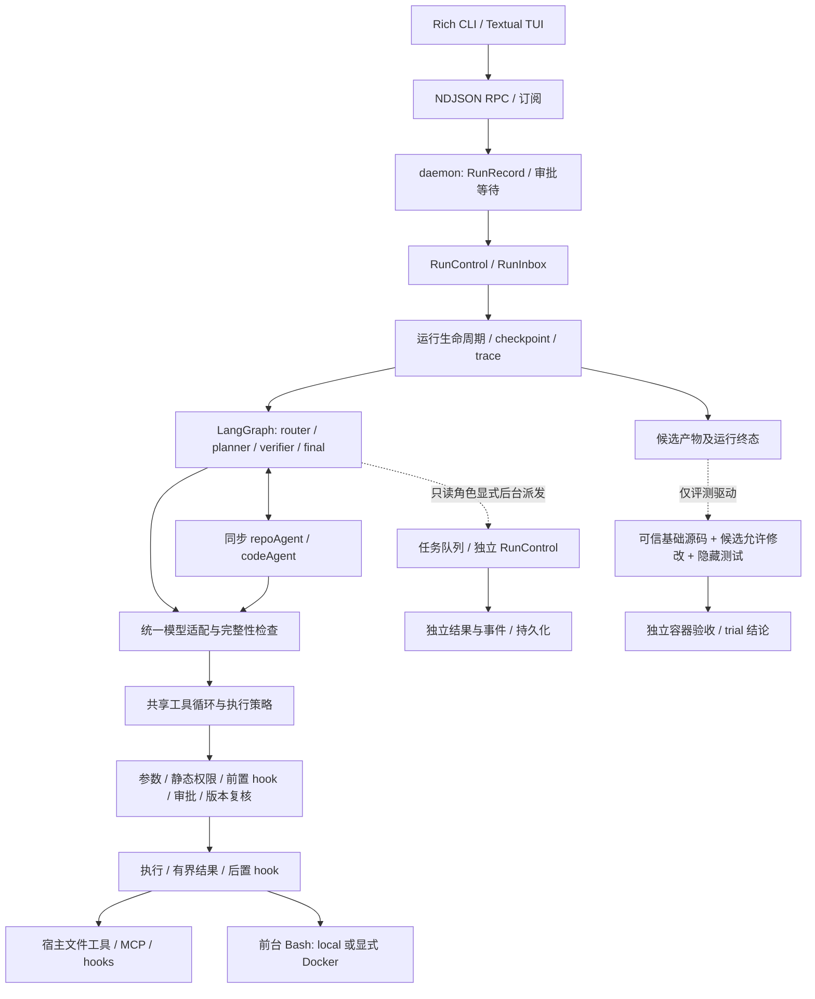

# 架构单页：执行与控制分层

定位：本地代码任务的教学型 Agent。默认 full/local，baseline 只用于评测；复杂度带来的可靠性收益需要实验验证。

| 边界 | 当前实现与源码 |
|---|---|
| UI / 传输 | [CLI](../../../src/mokioclaw/cli/app.py)、[TUI](../../../src/mokioclaw/cli/tui/app.py)、[daemon](../../../src/mokioclaw/core/daemon.py)负责交互与订阅；客户端断线不等于取消 |
| 运行与图 | [生命周期](../../../src/mokioclaw/core/runner/lifecycle.py)、[图](../../../src/mokioclaw/graph/workflow.py)管理路由、上下文、重规划和收尾；trace 在路由前建立 |
| 模型与工具 | [provider](../../../src/mokioclaw/providers/openai_provider.py)、[共享循环](../../../src/mokioclaw/core/tool_loop.py)、[执行器](../../../src/mokioclaw/tools/execution.py)隔开生成与副作用；完整响应还要通过工具 schema |
| 子任务 | [同步 runner](../../../src/mokioclaw/agents/registry.py)沿用前台控制；[后台派发](../../../src/mokioclaw/graph/steps/delegation.py)创建独立控制与运行状态，只接收允许后台的只读角色 |
| 持久化 / 验收 | [checkpoint](../../../src/mokioclaw/core/checkpoint.py)、[trace](../../../src/mokioclaw/core/trace.py)保留进展；[独立 grader](../../../src/mokioclaw/evaluation/grader.py)在可信环境重建测试，不能由模型自评分替代 |

工具链：参数校验 → 静态权限 → PreToolUse → 审批 → 取消/指令/参数/策略/后端版本复核 → 执行与允许的重试 → 有界结果 → PostToolUse。被拒绝或未执行的调用不触发后置 hook；前后 hook 按逻辑调用执行一次。

同步子任务的已完成副作用保留；前台取消阻止后续步骤。显式后台任务有独立生命周期，父任务取消不等于后台取消。Docker 只是命令后端，不隔离宿主的模型调用、文件工具、MCP 或 hooks。
