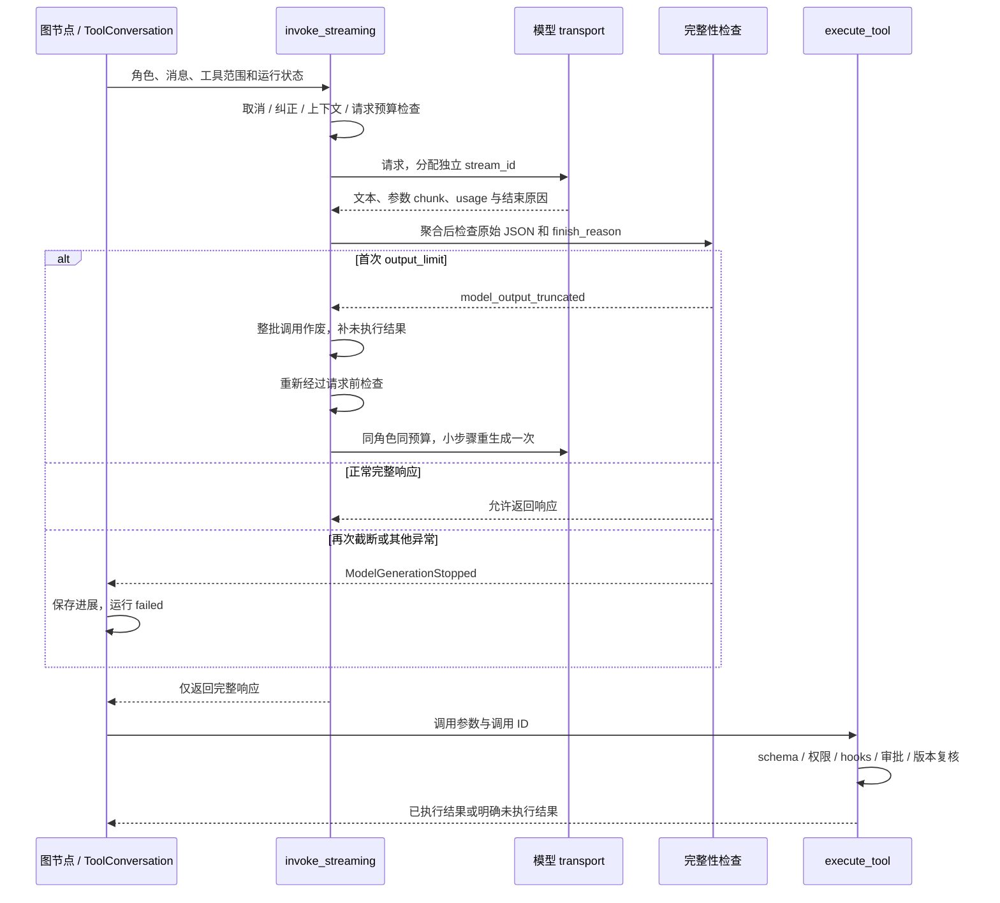
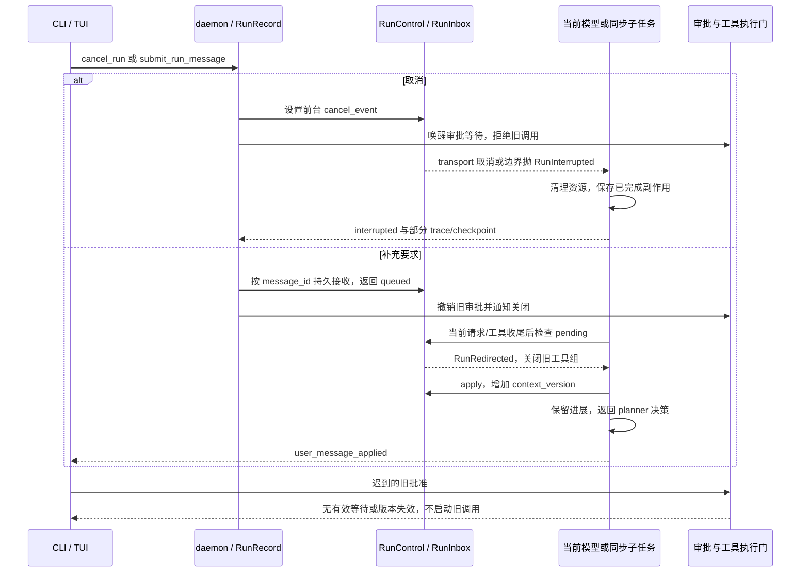
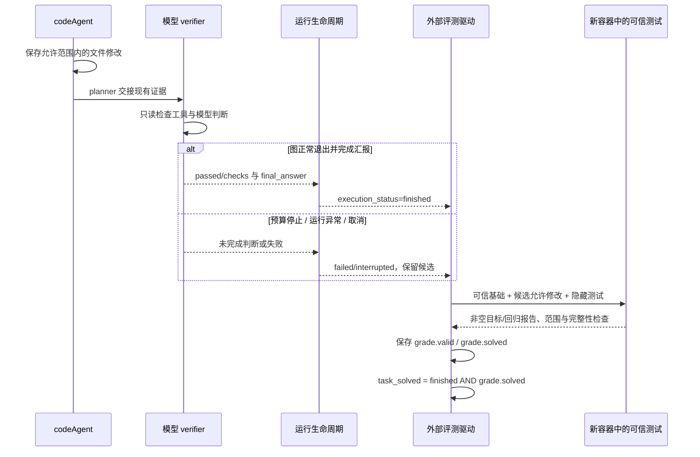

# 三条执行链：从行为走到源码

以下是当前 `5be75d9` 产品代码的静态阅读，不表示又执行了真实模型。源码行链接指向关键入口；历史案例保持各自冻结版本。

## 1. 模型响应 → 完整性检查 → 工具执行

源码：[请求与重生成](../../../src/mokioclaw/providers/openai_provider.py#L86)、[结束原因与原始 JSON](../../../src/mokioclaw/providers/generation.py#L66)、[共享循环](../../../src/mokioclaw/core/tool_loop.py#L21)、[执行门](../../../src/mokioclaw/tools/execution.py#L230)、[失败收尾](../../../src/mokioclaw/core/runner/lifecycle.py#L173)。

不变量：`length/max_tokens` 即使带一个完整调用也整批不执行；SDK 容错补全不是参数完整的证据；工具 schema 是第二道校验。每个实际请求单独计量和结束，最多重生成一次。内容过滤、异常结束、空流、非法原始参数不会进入普通回复降级。

正常路径返回响应后仍须通过工具策略。失败路径保留部分输出、`stop_reason` 和 checkpoint；取消或新要求能阻止额外请求。边界：兼容模型缺少结束原因时仍允许调用，但只能检查实际可取得的原始参数，不能证明供应商省略的字段。

证据：[混合完整/半截调用、重复截断与取消测试](../../../tests/test_generation_reliability.py)。可运行 `uv run --no-sync pytest -q tests/test_generation_reliability.py`，全为可控模型，不请求网络。

## 2. 取消／补充指令 → 旧调用与审批失效

源码：[运行控制](../../../src/mokioclaw/core/run_control.py#L20)、[RPC 接收和审批撤销](../../../src/mokioclaw/core/daemon.py#L226)、[批次未执行结果](../../../src/mokioclaw/core/run_inbox.py#L24)、[重规划循环](../../../src/mokioclaw/core/runner/events.py#L6)、[工具前复核](../../../src/mokioclaw/tools/execution.py#L394)。

不变量：补充指令在生产者的步骤边界生效，不能由尚在转发 token 的消费者提前清空队列；同步子任务返回既有进展并关闭旧调用组；完成与消息接收使用同一条件边界，已确认接收的消息不能被最终完成吞掉。重复消息去重，迟到批准不能恢复过期参数、上下文、权限或执行后端。

正常路径中补充要求触发 planner 重新决策，取消以 `interrupted` 收尾。失败路径不能把 `RunInterrupted` 当普通工具错误重试。边界：已开始的普通同步工具在现有超时内收尾，不回滚已发生的副作用；显式后台 Subagent 使用独立控制，不随前台 Ctrl+C 停止；Ctrl+Q/断线保留重连语义。

证据：[真实 daemon 审批纠正测试](../../../tests/test_optimization_integration.py#L246)、[同步子任务纠正测试](../../../tests/test_optimization_integration.py#L413)、[前台取消与后台隔离](../../../tests/test_run_cancellation.py#L194)、[幂等接收和完成门](../../../tests/test_project_optimization.py#L197)。

## 3. 修改产物 → verifier → 独立验收 → trial 最终结论

关键区别：**独立验收在评测驱动中、运行退出之后执行**，不是 daemon 或每次普通交互的必经节点。运行终态不会因为后续测试绿色而改写；trial 的完整交付结论在外部评分后产生。不能把图画成“独立评分决定 daemon 的 finished”。图正常退出也可能汇报内部 FAILED；`finished` 表示运行正常结束，不自动等于 verifier 通过。

源码：[verifier 与轮次上限](../../../src/mokioclaw/graph/steps/review.py#L7)、[资源清理及终态](../../../src/mokioclaw/core/runner/lifecycle.py#L213)、[可信重建](../../../src/mokioclaw/evaluation/grader.py#L45)、[非空评分条件](../../../src/mokioclaw/evaluation/grader.py#L147)、[运行后评分与合取判定](../../../src/mokioclaw/evaluation/runner.py#L286)。

不变量：Agent 改过的测试与配置不能直接评分；非空报告和退出码必须可核对，越界修改保留并判不通过。模型自评、内部 verifier、运行终态、独立评分分别记录，缺失判断是未知。

正常证据是 [D01 finished 与 5 项测试](../../experiments/completion/d01/trials/D01-full-1/result.json)。失败证据是 [B1/M08-v2-full-1](../../experiments/job-readiness-goal2/b1/trials/M08-v2-full-1/result.json)：`grade.solved=true`、13 项测试，但 `execution_status=failed`、`task_solved=false`。[空/伪造报告负控制](../../../tests/test_internship_eval.py#L65)防止“只写成功文本”通过。

边界：固定测试只能证明覆盖要求；当前 verifier 的实际收敛问题尚未解决，不能把交接成功宣传为完整交付率改善。参见[失败定位](cases.md)与[核心取舍](tradeoffs.md)。
