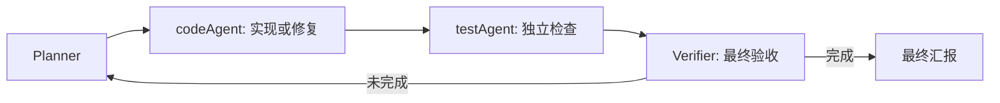

# 独立测试 Agent

`testAgent` 是第四个内置子 Agent，专门负责实现后的检查和失败诊断。它与最终 Verifier 分工：测试角色执行并整理证据，Verifier 对照完整用户要求判断任务是否交付。



## 自动调用

- full 流程：实现角色的同步交接使旧测试报告失效，下一次验收前自动进入测试节点；只做研究且未派发实现的任务不额外请求测试模型。
- light / auto 的轻量路径：实现后先测试，再验收。升级 full 时沿用已有工作，重新测试后续实现。
- Planner 也可通过已有 `CallSubagentTool(subagent_name="testAgent", instruction=...)` 单独复测。有效复测会清除待测试标记；之后再派发代码实现仍会使其失效。
- 单 Agent 评测 baseline 维持原定义，不增加测试子 Agent；历史冻结实验不会重跑，也不把原有结果归属于新增角色。

## 能力与边界

默认工具为 FileRead、Grep、FileGlob 和 Bash，工具预算 8 次，可通过现有 Subagent 配置调整。支持角色模型配置及 `base="testAgent"` 的声明式角色，能力只能收窄。

首版独立查看代码和测试、选择相关命令、执行检查并报告覆盖缺口；需要补充测试或修复实现时由 Planner 重新委派 codeAgent。测试角色没有 FileWrite/FileEdit、网页搜索、MCP 或任务完成写入工具，不能作为后台角色启动。Bash 继续经过原权限、hooks、审批、取消和执行后端；正常测试可产生缓存和报告，这不是文件系统只读沙箱。

## 报告和判定

`test_report` 包含运行时计算的 `status`、模型摘要、实际命令、调用 ID、退出码、超时、头部输出及日志引用。状态由实际工具结果生成：

| 状态 | 含义 |
|---|---|
| passed | 已观察到命令执行且全部正常退出；表示这些检查成功，不自动代表完整任务成功 |
| failed | 观察到非零退出码 |
| incomplete | 检查被拒绝、超时、工具错误、未知退出码或预算/轮数耗尽 |
| not_run | 没有执行命令；不能表述为“测试通过” |

模型即使输出“全部通过”，也不能覆盖非零退出码。失败、未完成及待测试状态阻止 Verifier 给出成功；有明确验证命令却未运行时也会阻止。没有命令的文件检查任务可由 Verifier 根据实际文件证据判断，但测试记录仍是 not_run。命令由模型选择，可信外部评分器仍用于独立任务评测，测试角色不能替代它。

若实现已触发预算收尾，测试节点不消耗原有最终验收预留，明确记录 `not_run / completion_budget_reserved`。其他路径仍服从请求前预算预留与硬上限；增加角色通常增加模型请求、工具次数和延迟，本轮不宣称改善真实成功率。

## 控制、压缩与恢复

共享 `ToolConversation` 和执行器保留生成完整性、取消、补充指令、审批和重试边界。中断前已完成的命令证据可写入 checkpoint；报告进入分层记忆及压缩事实。light / strict 恢复均把旧测试结果当作历史观察，重新标记待测，防止沿用用户后续修改前的结果。

Rich / TUI 显示 testAgent 的模型和工具事件及报告状态；trace 通过原有 run / stream / handoff / tool ID 关联。

## 离线复现

```sh
uv run python examples/testing_agent_demo.py
uv run pytest -q tests/test_testing_agent.py tests/test_crewai_orchestration.py
make check
```

示例使用固定模型，真实运行本地 pytest：错误实现退出 1，修正实现退出 0。两次模型均故意声称“All tests passed”，实际状态仍分别是 failed / passed。输出明确标记 simulation=true、real_model=false；不访问真实模型，不计真实任务成绩。

已有预备镜像时可验证同一执行链的容器后端：

```sh
uv run python examples/testing_agent_demo.py --execution-backend docker --docker-image YOUR_PREPARED_IMAGE
```


## 本轮验证

实际项目全量为 **511 passed / 2 skipped**；Ruff、39 个严格 mypy 模块与文档/diff 检查通过。本地及真实 Docker 演示均观察到错误实现退出 1、修正实现退出 0。[完整记录与失败保留](experiments/testing-agent-v1/README.md)。没有新增真实模型实验或远程操作。

若 daemon 已常驻，待当前任务结束后用 `uv run mokioclaw daemon stop` 停止旧进程，再运行 CLI/TUI 自动启动新进程，加载新的角色注册表。
